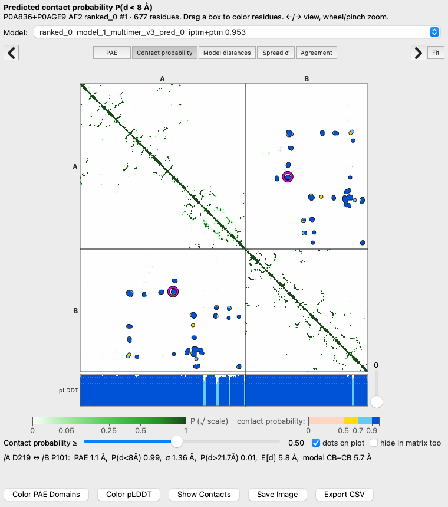
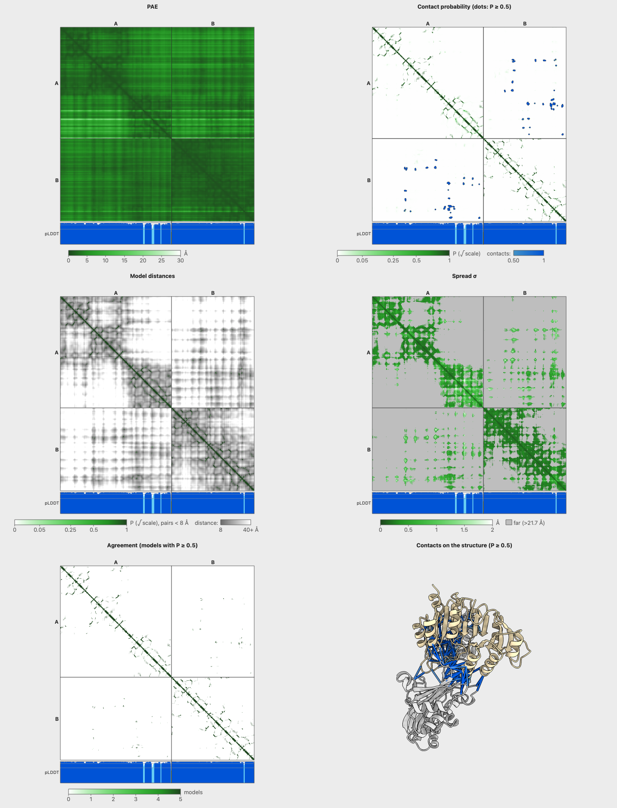
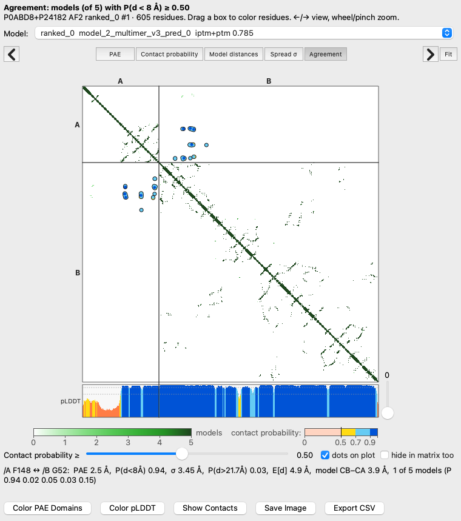

# ChimeraX-AlphaLens

*Formerly DistoPAE (up to version 0.4). The `distopae` command still works.*

A [ChimeraX](https://www.cgl.ucsf.edu/chimerax/) plot for AlphaFold2 and AlphaFold3 predictions. Like
ChimeraX's built-in AlphaFold error plot, it shows the PAE matrix with a pLDDT track. It adds views
computed from the predicted distogram, compares the predicted contacts with the contacts in the
model, shows which contacts are reproduced across seeds or models, draws the predicted contacts on
the structure and exports them to CSV.

*The contact-probability view for an AlphaFold2 prediction of E. coli succinyl-CoA synthetase,
SucC–SucD (UniProt P0A836, P0AGE9). Blue dots mark the inter-chain pairs with P ≥ 0.5, darker for
higher P. The one ringed in gold was clicked; its values are in the line under the slider.*

| View | Matrix | Colors (dark = confident) |
|---|---|---|
| PAE | predicted aligned error (Å) | 0–30 Å |
| Contact probability | predicted P(d < 8 Å) from the distogram, or AF3 `contact_probs` if there is no distogram | √P scale, so weak contacts show |
| Model distances | CB–CB distances in the shown model; the pairs closer than 8 Å (contacts in the model) colored by the predicted P | distances grey, 8 Å dark to 40 Å and beyond white; contacts as the contact-probability view |
| Spread σ / H | standard deviation (Å) or entropy (bits) of the predicted distance distribution | 0 to the 99th percentile of the model |
| Agreement | number of AF3 seeds or AF2 models in which the pair has P ≥ the slider threshold | 0 to the number of seeds or models |

*The five views of the same prediction, each with the predicted contacts as blue dots, and its
inter-chain contacts with P ≥ 0.5 drawn on the structure by Show Contacts. In the spread view, grey marks pairs whose distance is mostly beyond
the last distogram bin. The agreement view counts the five AlphaFold2 models in which each pair has
P ≥ 0.5.*

## Install

Requires ChimeraX 1.6 or newer; tested with 1.10 and 1.12. The bundle is pure Python, so one wheel works on
macOS, Linux and Windows.

1. Download `chimerax_alphalens-<version>-py3-none-any.whl` from the
   [Releases](https://github.com/KosinskiLab/AlphaLens/releases) page. Keep the file name:
   pip needs it.
2. In the ChimeraX command line:

       toolshed install ~/Downloads/chimerax_alphalens-0.10.0-py3-none-any.whl

3. Restart ChimeraX.

`toolshed list` shows the installed version (look for AlphaLens). To update, install the newer wheel
in the same way. To remove the bundle, run `toolshed uninstall AlphaLens`.

**Upgrading from DistoPAE:** install AlphaLens as above, then remove the old bundle with
`toolshed uninstall DistoPAE` and restart ChimeraX. Scripts that call `distopae` keep working.

### From source

    git clone https://github.com/KosinskiLab/AlphaLens.git

Then, in the ChimeraX command line, change to the checkout first:

    cd /path/to/AlphaLens
    devel install .        # install from the checkout
    devel build .          # or only build the wheel into dist/
    devel clean .          # remove build files

ChimeraX builds a `pyproject.toml` bundle from its current directory, whatever path is given to
`devel`: without the `cd`, `devel install` fails with "package directory 'src' does not exist"
(seen in ChimeraX 1.10).

## Quick start

    alphalens open /path/to/prediction_dir            # top-ranked model
    alphalens open /path/to/prediction_dir rank 2     # AF2 ranked_2 / AF3 third-best sample
    alphalens open /path/to/seed-1_sample-0/model.cif # one AF3 sample

`open` can be left out: `alphalens /path/to/prediction_dir` does the same.

For a structure that is already open, use Tools > Structure Prediction > AlphaLens (when exactly
one structure is open) or `alphalens #1`.

The plot reads the PAE file next to the structure, plus the distogram if the prediction kept it.
If the distogram is missing, you get the PAE view and, for AF3, the contact view from
`contact_probs` from the same seed. A missing seed distogram is never replaced by another seed's
distogram. A top-level AF3 model needs a readable `ranking_scores.csv` to identify its seed;
without it, open the specific `seed-S_sample-K/model.cif` or supply a known matching
`distogram` explicitly. The tabs that need unavailable data are greyed out with a tooltip saying why.
A readable PAE file is required; an unreadable optional distogram still leaves the PAE view usable.
Explicit requests for views, contacts or CSV export fail if their required data cannot be loaded.

## Getting a distogram

The contact view needs either a distogram or AF3 `contact_probs`; the spread view needs a
distogram. AF3 always writes `contact_probs` to its confidences file, but most pipelines do not
keep the distogram by default:

| Predictor | Setting | Where the distogram ends up |
|---|---|---|
| AlphaFold2 (`run_alphafold.py`) | kept by default | `result_<model>.pkl`, key `distogram` |
| AlphaPulldown, AlphaFold2 backend | `--noremove_keys_from_pickles`, and `--storage_mode vanilla` (the default) if your version has the option | `result_<model>.pkl[.gz\|.xz]` |
| AlphaFold3 v3.0.2 or newer | `--save_distogram` | `seed-<S>_distogram/<name>_seed-<S>_distogram.npz` |
| AlphaPulldown 2.1.4 or newer, AlphaFold3 backend | `--save_distogram` | as for AlphaFold3 |
| ColabFold | `--save-all` (untested) | `*_all_rank_NNN_*.pickle` |

A distogram holds N × N × 64 values, so it is large: a 2,000-residue complex gives about 0.5 GB
(AF3, float16) or 1 GB (AF2, float32) before compression. The plot opens at once with PAE, and for
AF3 with the contacts from `contact_probs`, and loads the distogram in the background. A progress
bar above the plot shows how far it has come; the Spread tab turns on when it finishes.

## Using the plot

* **Views:** arrows, tabs or the ← / → keys. Hovering shows the values for a residue pair.
* **Zoom:** scroll wheel, trackpad pinch, or + / −. **Pan:** Shift-drag or middle-drag. **Fit**
  (or 0 / Esc) resets the view. Matrices larger than 900 residues are pooled for display
  (contacts max-pooled, so no contact disappears; PAE and spread mean-pooled). When you zoom in,
  the visible region is redrawn at full resolution, and hovering always reports the exact
  per-residue values.
* **Model:** the dropdown lists the AF2 ranked models or AF3 samples of the same prediction that
  are present locally. The chosen model opens in the same window, superposed on the previous one,
  which is hidden; the view and zoom are kept.
* **Contact dots:** in every view, inter-chain pairs above the slider threshold (pairs at least
  24 matrix positions apart for a single chain) are drawn as blue dots that stay visible at any
  zoom, darker blue for higher P (the scale is next to the color bar). Right-click to turn them
  off, or to keep them to the contact-probability view. At most the 40,000 strongest pairs are
  shown as dots; CSV export is not capped by this display limit.
* **Hide by pLDDT:** the vertical slider right of the pLDDT track hides the parts of the model
  with pLDDT below its value; a line marks the value and hidden residues fade on the track.
* **Hide selected:** drag along the pLDDT track to select residues, then right-click the plot and
  choose Hide selected. It also hides residues selected in the 3D view. Show hidden restores them.
* **Predicted contacts P ≥ slider:** one threshold (0.05–1, default 0.2) for the dots, the 3D
  lines, the agreement view and the CSV export. "hide in matrix too" also blanks matrix pixels
  below it.
* **Show Contacts:** draws all predicted contacts above the slider threshold on the structure as
  CA–CA lines, in the same blue as the dots, thicker for higher P; weak contacts are drawn
  semi-transparent, so the confident interfaces stand out. Move the slider down to 0.05 to see
  every contact. Up to 10,000 lines are drawn, strongest first.
* **Click a dot:** draws that contact on the structure as a thick gold line (the plot rings the
  dot in the same gold), labels both residues and shows their side chains. The log gives P, both
  PAE values, the expected distance (with a distogram) and the CA–CA distance in the model.
  Clicking another dot replaces it. Right-click > Clear clicked contact removes it; with
  right-click > Zoom 3D view to clicked contact switched on, the camera also moves there.
* **Drag a box:** only the contacts inside it, above the slider threshold, are drawn on the
  structure, for example the block between two chains; a click on empty plot space or Show
  Contacts restores all. The log lists the strongest pairs. By default, dragging a box also colors
  those residues (an off-diagonal box uses two colors); this can be switched off in the
  right-click menu.
* **Model distances:** the distances between the CB atoms (CA for glycine, the atoms the
  distogram describes) in the shown model, in grey from 8 Å (dark) to 40 Å and beyond (white).
  The pairs closer than 8 Å, the contacts in the model, are colored by the predicted contact
  probability on the same scale as the contact-probability view, so one matrix shows how far apart
  the parts of the model are and which of its contacts the prediction supports. Contacts with P
  near 0 get the lightest green, so none disappears; in a zoomed-out overview the contacts are
  kept over the distances. Flip to the contact-probability view with ← / → at the same zoom: a
  contact that is predicted but grey here is not formed in this model. Hovering gives the CB–CB
  distance in the model in every view. Without contact probabilities (AF2 without a distogram)
  the contacts are drawn in one color.
* **Color pLDDT** colors the structure in the four AlphaFold pLDDT bands (< 50, 50–70, 70–90,
  > 90), as the pLDDT track of the plot, instead of ChimeraX's smooth "alphafold" palette.
* **Color PAE Domains** colors the structure using ChimeraX's PAE domain clustering.
* Large models that ChimeraX shows as spheres are switched to cartoon the first time contact lines
  are drawn, because the lines would otherwise be hidden inside the atoms.
* **Spread:** the last distogram bin collects every distance above 21.7 Å, so the spread is
  undefined where that bin dominates. Pairs with P(d > 21.7 Å) > 0.5 are drawn grey; the threshold
  is in the right-click menu.
* **Right-click menu:** contact color scale (√P, linear, or bands at 0.05 / 0.2 / 0.5 / 0.8),
  spread as standard deviation or entropy, color the plot from the structure, chain divider
  lines, pLDDT track, Log agreement table, and Save image.

With more than one chain, the log gets an interface table per chain pair: maximum P, number of
residue pairs with P > 0.5, and minimum PAE.

The data are also attached as `structure.alphafold_pae`, so ChimeraX's own commands, such as
`alphafold pae #1 colorDomains true` and `alphafold contacts`, work on the same model.

## Agreement between seeds and models

A contact predicted by one seed but not by the others is weak evidence. The **Agreement** view
counts, for every residue pair, the independent runs of the prediction in which P(d < 8 Å)
reaches the slider threshold:

* **AlphaFold3:** one run per seed. The samples of a seed share one distogram and the same
  `contact_probs`, so they are not independent. The seed's distogram is used if it was saved,
  otherwise the `contact_probs` of one of its samples.
* **AlphaFold2:** one run per model (`model_1` … `model_5`, and every prediction per model). The
  result pickles must have kept the distogram (see [Getting a distogram](#getting-a-distogram)).

The seeds' or models' files must be present, not only the top model's: for AF3, the
`seed-*_sample-*` folders (or `seed-*_distogram`). `scripts/fetch_pred.sh` copies them. If they are
missing, the tab stays grey and its tooltip says how many seeds have files.

*E. coli AccB–AccC (UniProt P0ABD8, P24182): no inter-chain pair reaches P ≥ 0.5 in all five
AlphaFold2 models. The hovered pair, in the line under the slider, has P 0.94 in one model and at
most 0.15 in the other four.*

The runs are read the first time the view is shown, in the background; five AF3 seeds of a
1,200-residue complex take a few seconds. Hovering shows the count and P in each run, for example
`2 of 5 seeds (P 0.91 0.12 0.88 0.05 0.07)`. Moving the slider recounts.

With more than one chain, the log gets a table per chain pair: the mean of the 10 highest
inter-chain P in each seed or model, and the number of seeds or models with a residue pair at
P ≥ the threshold. Right-click > Log agreement table logs it again for the current threshold.
The agreement data are kept when you switch to another model of the same prediction.

## Export to CSV

**Export CSV** saves the contacts with P ≥ the slider threshold: inter-chain pairs (long-range
pairs for a single chain), only those inside the dragged box if there is one. With the agreement
loaded, a pair is included if it reaches the threshold in any seed or model. One row per residue
pair, most reproduced and most probable first:

| Column | Content |
|---|---|
| `chain_1`, `residue_1`, `name_1`, `atom_1` (and `_2`) | the two residues; `atom` only for ligand atoms in AF3 |
| `p_contact` | P(d < 8 Å) in the shown model |
| `pae_1_2`, `pae_2_1` | PAE in both directions (Å) |
| `expected_distance` | mean of the predicted distance distribution (Å; needs a distogram; capped by the last bin at 21.7 Å) |
| `model_distance` | distance in the shown model between CA atoms (C4′ for nucleotides, the atom itself for ligands) (Å) |
| `seeds_with_p_ge_0.20`, `seeds` | with the agreement loaded: in how many of how many seeds (or `models`) the pair reaches the threshold |
| `p_seed_<S>` / `p_model_<N>` | P in each seed or model |

## Sessions

`save mysession.cxs` keeps the plot with the session. The session stores the plot's settings and
the paths of the PAE file and the distogram, never the matrices, so it stays small. When it opens,
the plot is rebuilt from those files with the same view, contact threshold, dragged box, clicked
contact, pLDDT slider and hidden residues. If the distogram has moved, the plot opens without
Spread; if the PAE file is gone too, the structure and its contact lines still open, without the
plot. Opening such a session needs AlphaLens 0.9 or newer. The plot's zoom and window position are
not saved.

## Commands

    alphalens [#model] [paeFile file] [distogram file]
             [mode pae|contact|distance|std|entropy|agreement]
             [cutoff 8] [contacts true|false] [minProb 0.5] [saveContacts file.csv]
             [palette name] [range low,high] [dividerLines true|false] [wait true|false]
    alphalens open path [rank N] [same options except paeFile]
    alphalens path [rank N] [...]          # same as "alphalens open path"

| Option | Meaning |
|---|---|
| `paeFile`, `distogram` | files with non-standard names; otherwise they are found next to the structure |
| `mode` | view to show: `contact` the predicted contact probability, `distance` the distances and contacts in the model (`model` also works), `std` / `entropy` the spread; `agreement` reads every seed or model first and logs the agreement table |
| `cutoff` | contact distance in Å (default 8), also for the contacts in the Model distances view; needs a distogram, because AF3 `contact_probs` are fixed at 8 Å |
| `contacts`, `minProb` | draw or remove the contacts with P ≥ minProb on the structure (default 0.5; also moves the slider) |
| `saveContacts` | write the contacts to a CSV file as Export CSV does, with P ≥ minProb if given, otherwise the slider threshold (0.2 without a plot) |
| `palette`, `range` | PAE color map, as in `alphafold pae` |
| `dividerLines` | chain divider lines on the plot |
| `wait` | finish the distogram and requested agreement loading before the command returns, including reads already running in the background; use `wait true` before consuming a GUI command's CSV output |
| `rank` | 0 = top model; AF2 `ranked_N`, AF3 N-th best sample |

For example, without a window (`ChimeraX --nogui`), this logs the agreement table and writes the
contacts reached in any seed, with P per seed:

    alphalens open /path/to/prediction_dir mode agreement saveContacts ~/contacts.csv

## Recognised layouts

* **AlphaFold2 / AlphaPulldown:** `ranked_N.pdb|cif` → order in `ranking_debug.json` →
  `pae_<model>.json` (or the PAE in the result pickle). The distogram is
  `result_<model>.pkl['distogram']`.
* **AlphaFold3:** `<name>_model.cif` + `<name>_confidences.json`, or `seed-S_sample-K/model.cif` +
  `confidences.json`. The distogram is `seed-S_distogram/*.npz` (key `distogram`; logits or
  probabilities are detected automatically).
* **ColabFold** (untested): `*_unrelaxed_rank_NNN_*.pdb` + `*_scores_rank_NNN_*.json`, and
  `*_all_rank_NNN_*.pickle` with `--save-all`.
* PAE JSON and result pickle files, and NPZ distograms, can be `.gz` or `.xz` compressed.
  AlphaFold DB PAE files are read too. For other layouts, give the files with `paeFile` and `distogram`.

## Predictions on a remote machine

Opening predictions over a network mount is slow, because every file lookup and the large result
pickles go over the network. It is faster to copy only the files the plot reads:

    scripts/fetch_pred.sh user@cluster:/path/to/prediction_dir ~/predictions

and then, in ChimeraX, `alphalens open ~/predictions/prediction_dir`. The script uses rsync, so it
needs ssh access to the machine. `--no-pickles` skips the AF2 / ColabFold result pickles, which are
large; without them the AF2 plot shows PAE only.

## Limitations

* AF3 `contact_probs` are fixed at 8 Å; another `cutoff` needs the distogram.
* The agreement view keeps N × N values per seed or model in memory (2 bytes each) and refuses
  more than 4 GB: five seeds work up to about 20,000 residues, twenty up to about 10,000.
* ColabFold layouts are untested, and have no model switching or agreement view.

## Development

The file readers, agreement, CSV export and command loading behavior are tested without ChimeraX:

    pip install numpy pytest
    pytest tests

For a headless integration check with real ChimeraX structures and commands, run from the checkout:

    ChimeraX --nogui --exit --cmd "open tests/chimerax_smoke.py"

This creates temporary synthetic AF2 and AF3 predictions and checks agreement, compressed
distograms, CSV export, seed matching and loading errors without installing the bundle.

The plot window itself is checked in a real ChimeraX window (Qt's offscreen mode crashes it), on
predictions with distograms:

    ALPHALENS_WINDOW_DIRS="/path/to/af3_prediction;/path/to/af2_prediction" \
        ChimeraX --exit --cmd "open tests/chimerax_window_check.py"

It opens each prediction as a user would and checks every view, the Model distances matrix, hover,
contacts on the structure, the clicked contact, pLDDT colors, CSV export, agreement and model
switching. It tests this checkout without installing it (`ALPHALENS_SOURCE=installed` tests the
installed bundle) and exits with status 1 if any check fails; the script header lists the options.
The release procedure for maintainers is `.claude/skills/alphalens-release/SKILL.md`.

The images in this README are rendered from the installed bundle by
`docs/render_readme_images.py`; its header says which predictions it needs and how to run it.

## License

MIT; see [LICENSE](LICENSE). Bug reports and questions go to the
[issue tracker](https://github.com/KosinskiLab/AlphaLens/issues).
